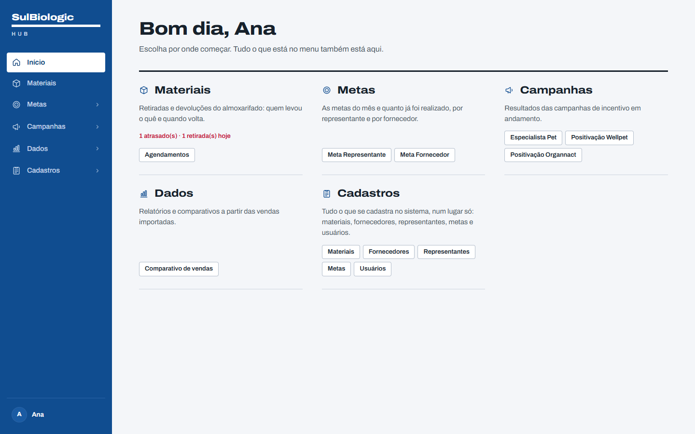
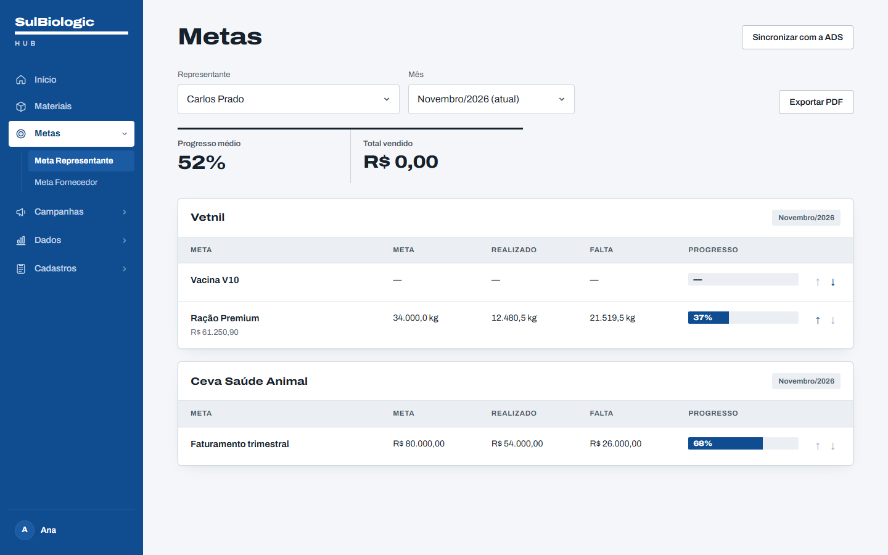
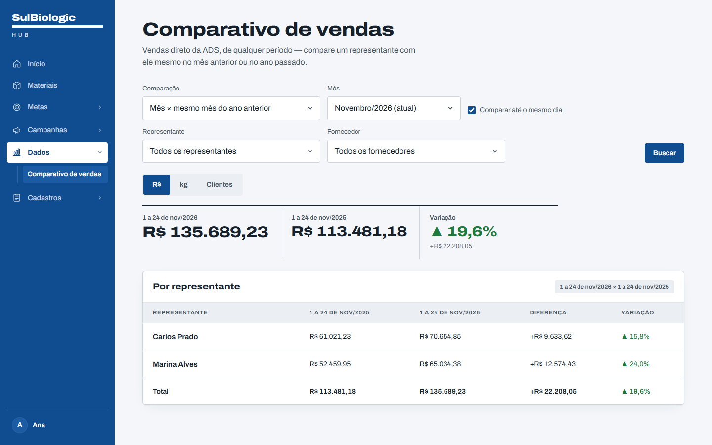
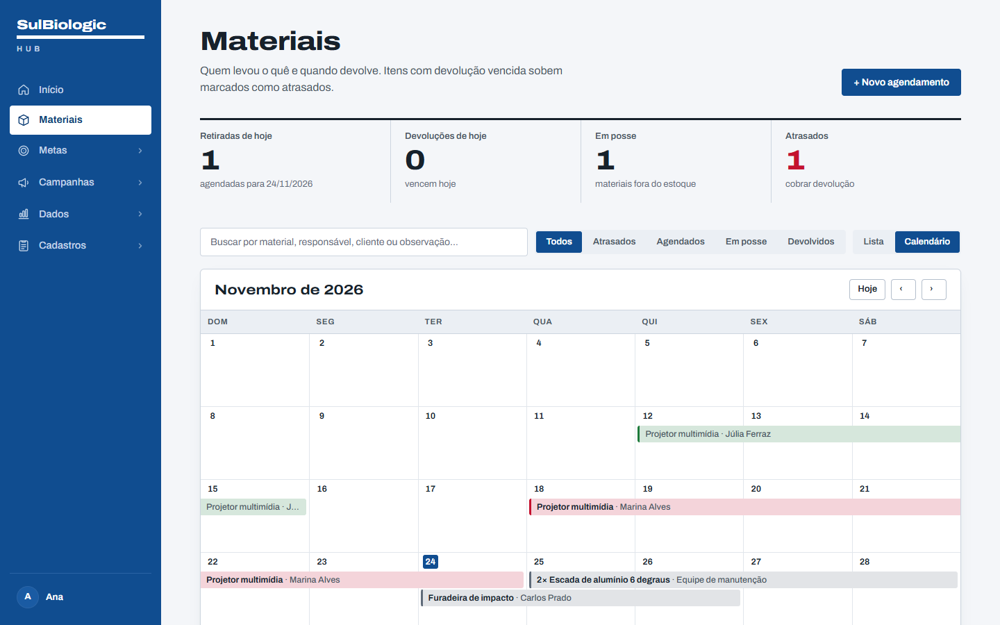
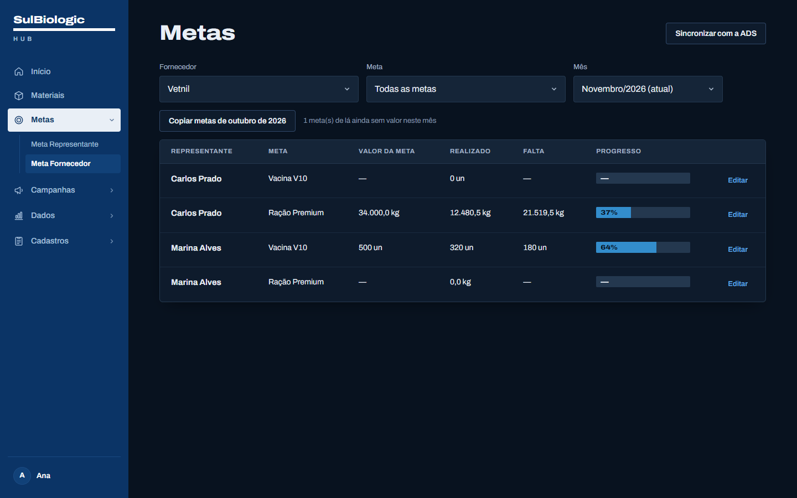
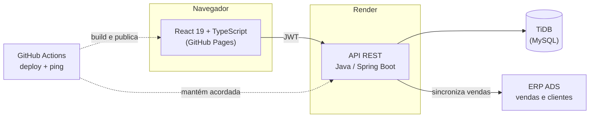

# SulBiologic Hub

Sistema interno de uma distribuidora de produtos veterinários e pet, em uso diário pelo escritório e pelos representantes de venda. Junta num lugar só o que antes vivia em planilhas: **metas de venda e quanto já foi realizado**, **campanhas de incentivo dos fornecedores**, **comparativo de vendas entre períodos** e o **almoxarifado** (empréstimo de materiais com atraso calculado).

**[▶ Abrir a demonstração](https://brunotaveiradasilva.github.io/sulbiologic-hub/demo/)** — roda no navegador com dados fictícios, sem login e sem servidor.



## O problema

A distribuidora fechava o mês em planilhas paralelas: a meta de cada representante numa, o realizado copiado do ERP (ADS) em outra, as campanhas de cada fornecedor com regras próprias em mais algumas. Os vendedores, na rua, perguntavam por WhatsApp quanto faltava pra bater a meta.

O Hub resolve isso puxando os números direto do ERP e aplicando as regras de cada meta e campanha:

- **Realizado é calculado, não digitado.** Vendas, kg vendidos e clientes positivados vêm da ADS e são somados por meta, respeitando divisão, fornecedor e produtos incluídos/excluídos de cada uma.
- **Cada representante vê só o que é seu**, no celular: meta, realizado, quanto falta e situação nas campanhas.
- **O escritório gera os PDFs** de metas e campanhas por representante e manda pelo WhatsApp.

## Funcionalidades

| Área | O que faz |
| --- | --- |
| **Metas** | Metas mensais por fornecedor e representante em R$, kg, unidades ou clientes positivados; visão por representante e por fornecedor; cópia das metas do mês anterior; exportação em PDF |
| **Campanhas** | Especialista Pet (importa a planilha do fornecedor e cruza com as vendas), positivação Wellpet e Organnact, com faixas de progresso e PDF por representante |
| **Dados** | Comparativo de vendas: mês × mesmo mês do ano anterior, mês × mês anterior, acumulado do ano ou períodos livres, filtrando por representante e fornecedor |
| **Materiais** | Atalho pro [Retira](https://retira-nine.vercel.app), o app próprio do almoxarifado (retiradas, devoluções e cadastro de materiais) |
| **Cadastros** | Fornecedores, representantes, metas e usuários; geração de logins em lote para os representantes |
| **Conta** | Quatro perfis de acesso (administrador, supervisor, representante, almoxarifado), troca de senha e foto |

| | |
| --- | --- |
|  |  |
|  |  |

## Arquitetura



- **Front-end (este repositório):** SPA em React + TypeScript + Vite, CSS puro com variáveis (temas claro e escuro), PDFs gerados no navegador com jsPDF.
- **Back-end:** API REST em Java/Spring Boot, com autenticação JWT e perfis de acesso, banco TiDB (compatível com MySQL) e integração com o ERP da distribuidora. O código dela fica num repositório privado.
- **Deploy:** cada push na `main` publica no GitHub Pages duas versões: o sistema real (`/`) e a demonstração (`/demo/`), que usa um back-end falso em memória.

### Organização do código

O `src/` é dividido por funcionalidade: cada pasta em `features/` tem as telas, o hook de estado e as regras de negócio daquela área.

```
src/
├── main.tsx
├── index.css                 # identidade visual, temas claro/escuro
├── types.ts                  # tipos de domínio compartilhados
├── app/                      # casca do app: login × painel, menu lateral, página inicial, navegação
├── api/
│   ├── api.ts                # cliente HTTP (token JWT, 401 → volta pro login, aviso de servidor lento)
│   └── apiMock.ts            # back-end falso em memória, usado na demo e no desenvolvimento
├── features/
│   ├── auth/                 # tela de login e sessão
│   ├── metas/                # metas por representante/fornecedor, realizado, PDF
│   ├── campanhas/            # Especialista Pet, Wellpet, Organnact (regras + PDFs)
│   ├── dados/                # comparativo de vendas entre períodos
│   ├── cadastros/            # fornecedores, representantes e metas
│   └── usuarios/             # usuários, geração de logins, Minha conta
└── shared/
    ├── components/           # Modal, seletores, estados vazios, barras de progresso
    └── lib/                  # datas, meses, unidades de meta
```

### Decisões que valem destacar

- **UI otimista:** criações aparecem na tela na hora com um id provisório (`shared/lib/idTemporario.ts`) e são reconciliadas quando a API confirma.
- **Back-end falso trocável por variável de ambiente:** `VITE_MOCK_API=true` faz toda chamada de `api.ts` cair em `apiMock.ts`, o que permite desenvolver a interface sem Docker e publicar a demo sem expor dados reais.
- **Servidor gratuito que dorme:** a API roda no plano gratuito do Render, que hiberna após 15 minutos. Um workflow agendado a mantém acordada, e o front mostra um aviso quando uma resposta demora (`features/auth/AvisoServidorAcordando.tsx`).
- **Regras de negócio fora dos componentes:** cálculo de atraso, período de meta, positivação e faixas de campanha ficam em módulos `.ts` puros, separados das telas.

## Rodando localmente

Requer Node.js 20 ou superior.

```bash
git clone https://github.com/brunotaveiradasilva/sulbiologic-hub.git
cd sulbiologic-hub
npm install
cp .env.example .env.local   # por padrão usa o back-end falso, sem precisar da API
npm run dev
```

O app abre em `http://localhost:5173` já logado como administrador, com dados de exemplo.

| Comando | O que faz |
| --- | --- |
| `npm run dev` | servidor de desenvolvimento |
| `npm run build` | checagem de tipos + build de produção em `dist/` |
| `npm run preview` | serve o build |
| `npm run lint` | análise estática com oxlint |

Para usar a API de verdade, defina `VITE_API_URL` (veja `.env.example`) e não use `VITE_MOCK_API`.

## Stack

React 19 · TypeScript · Vite · CSS puro · jsPDF · oxlint · GitHub Actions · GitHub Pages · Java/Spring Boot · TiDB

## Licença

[MIT](LICENSE)
